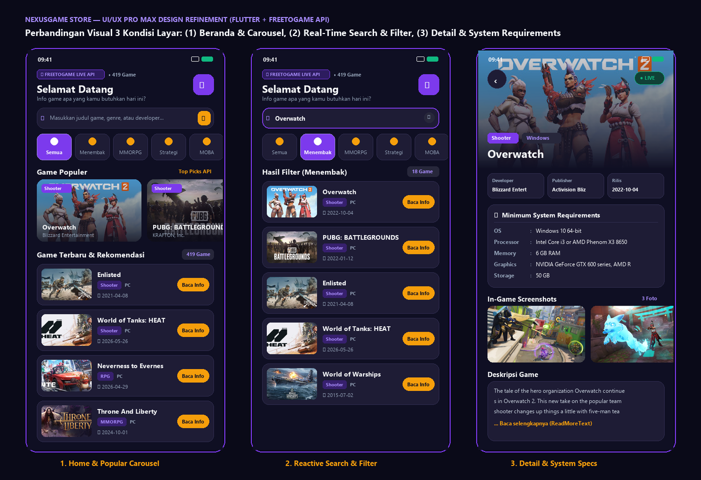

# 🎮 NexusGame Store — Aplikasi Katalog Game Free-to-Play Berbasis REST API

**Proyek Ujian Tengah Semester (UTS) Pemrograman Mobile**  
**Disusun Oleh:** Muhammad Nailul Ghufron Majid (`240605110160`)  
**Program Studi:** Teknik Informatika — Fakultas Sains dan Teknologi  
**Institusi:** Universitas Islam Negeri Maulana Malik Ibrahim Malang  
**Repositori GitHub:** [https://github.com/nailulgh/UTS_Teory_Game_App](https://github.com/nailulgh/UTS_Teory_Game_App)



---

## 📌 1. Gambaran Umum Aplikasi
**NexusGame Store** adalah aplikasi *mobile* berbasis **Flutter & Dart** yang menyajikan katalog ratusan game *free-to-play* lintas platform (PC & Web Browser) secara *real-time* menggunakan penyedia data eksternal **FreeToGame REST API** (`https://www.freetogame.com/api`).

Aplikasi ini mengadopsi sistem desain **Obsidian Gaming Dark & Electric Violet (`#0F0F23` & `#7C3AED`)** dengan arsitektur **MVVM (`model/`, `view/`, `viewmodel/`)** yang memisahkan lapisan model serialisasi JSON, logika pemanggilan HTTP asinkron, dan antarmuka pengguna yang responsif.

---

## ✨ 2. Fitur Utama Aplikasi
1. **Integrasi Data Dinamis REST API (`http`):**
   * Mengambil katalog game aktif dari endpoint `GET https://www.freetogame.com/api/games`.
   * Mengambil spesifikasi lengkap dan *screenshots* per game dari endpoint `GET https://www.freetogame.com/api/game?id={id}`.
2. **Pencarian *Real-Time* & Filter Kategori Genre Interaktif:**
   * *Search Bar* reaktif untuk mencari game berdasarkan judul, genre, maupun *developer*.
   * *Horizontal Genre Chips* (*Semua, Menembak/Shooter, MMORPG, Strategi, MOBA, Balap, Olahraga*).
3. **Carousel "Game Populer" & Kartu Katalog 16:9:**
   * Menampilkan *Hero Carousel* game unggulan serta daftar game dengan rasio gambar *16:9*, *badge* genre/platform, tanggal rilis, dan tombol aksi **"Baca Info"**.
4. **Halaman Detail Komprehensif (`Named Routes`):**
   * *Hero Cover Artwork* dengan *gradient scrim*, *Bento Metadata Grid* (*Developer, Publisher, Release Date*), kartu **Minimum System Requirements**, galeri *In-Game Screenshots* horizontal, dan deskripsi interaktif (`ReadMoreText`).

---

## 🛠️ 3. Teknologi & Package yang Digunakan
* **Flutter SDK & Dart:** Toolkit UI multiplatform dan bahasa pemrograman utama.
* **http (^1.1.0):** Komunikasi jaringan protokol HTTP GET asinkron ke endpoint server REST API.
* **json_annotation (^4.9.0) & json_serializable (^6.7.1):** Deserialisasi objek JSON bersarang (*nested JSON*) menjadi class model Dart yang *type-safe*.
* **build_runner (^2.4.8):** Alat otomasi *code generation* untuk menghasilkan berkas `detailgame.g.dart`.
* **readmore (^2.2.0):** Komponen ekspansi teks deskripsi panjang secara ringkas dan interaktif pada halaman detail.
* **cupertino_icons (^1.0.8):** Aset ikon grafis pendukung antarmuka pengguna.

---

## 📂 4. Struktur Folder Proyek
```text
lib/
├── model/
│   ├── game.dart               # Model data item katalog game (fromJson)
│   ├── detailgame.dart         # Model detail game, screenshot & spesifikasi (@JsonSerializable)
│   └── detailgame.g.dart       # Kode hasil generasi otomatis json_serializable & build_runner
├── viewmodel/
│   └── fetchgame.dart          # Service HTTP GET asinkron ke FreeToGame API
├── view/
│   ├── home.dart               # Halaman Utama (Header, Search, Filter Genre, Carousel & ListView)
│   └── detail.dart             # Halaman Detail Game (Hero Banner, Bento Info, System Req, Gallery)
└── main.dart                   # Entry point aplikasi, tema global & konfigurasi Named Routes
```

---

## 🚀 5. Cara Menjalankan Proyek
1. Pastikan **Flutter SDK** telah terpasang dan perangkat/emulator terhubung.
2. Unduh seluruh paket dependensi:
   ```bash
   flutter pub get
   ```
3. *(Opsional)* Jalankan generator serialisasi JSON jika memodifikasi model:
   ```bash
   dart run build_runner build --delete-conflicting-outputs
   ```
4. Jalankan pengujian otomatis:
   ```bash
   flutter test
   ```
5. Jalankan aplikasi:
   ```bash
   flutter run
   ```
